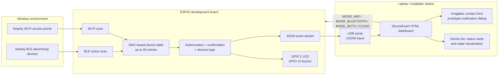

# SecureExam
## ESP32-Based Mobile Activity Detection and Remote Invigilator Notification

SecureExam is a prototype examination-room wireless monitoring system. An ESP32 scans nearby Wi-Fi access points and Bluetooth Low Energy (BLE) advertisements, identifies observed devices by MAC address, classifies them using a simple authorization rule, and streams structured JSON events over USB serial to a laptop-based HTML dashboard.

> **Project status:** Prototype / development project. This repository documents the supplied firmware and dashboard. Detection accuracy, classroom suitability, and all alert paths must be validated in the intended environment before operational use.

## Project overview

- **Controller:** ESP32 development board
- **Wireless interfaces:** ESP32 Wi-Fi scan and BLE active scan
- **Host interface:** USB serial at 115200 baud
- **Dashboard:** Standalone HTML/CSS/JavaScript page using the browser Web Serial API
- **Default authorized Wi-Fi SSID:** `SIMATS`
- **Bluetooth authorization:** All BLE devices are currently classified as unauthorized by the supplied firmware
- **Device table capacity:** 60 entries
- **Device expiry:** 15 seconds without an observation
- **Confirmation threshold:** Two observations (the firmware counter is incremented on each observation, not on a distinct complete scan cycle)

## System block diagram

The diagram below is written in Mermaid and is rendered directly by GitHub in this README.



## Repository structure

```text
.
├── README.md
├── LICENSE
├── .gitignore
├── src/
│   └── secure_exam_esp32.ino
├── web/
│   └── dashboard.html
├── hardware/
│   ├── components.md
│   └── pin-connections.csv
├── docs/
│   ├── algorithm.md
│   ├── system-architecture.md
│   ├── design-decisions.md
│   ├── testing.md
│   ├── known-limitations.md
│   └── contribution-and-ai-disclosure.md
└── media/
    └── README.md
```

## How it works

1. The ESP32 initializes Wi-Fi in station mode and initializes BLE active scanning.
2. Wi-Fi networks are scanned at a 5-second interval while Wi-Fi monitoring is enabled.
3. BLE advertisements are scanned for 3 seconds while Bluetooth monitoring is enabled.
4. Each observation is associated with a MAC address. Existing entries are updated; new entries are added until the 60-entry limit is reached.
5. The firmware marks the Wi-Fi SSID `SIMATS` as authorized. Other Wi-Fi SSIDs and all BLE observations are unauthorized under the current rule.
6. A device is considered for the hardware alert when its observation counter reaches two and it is not authorized.
7. Devices not observed for more than 15 seconds are removed from the device table.
8. JSON events are sent to the laptop dashboard. The dashboard also sends the supported monitoring-mode and clear commands over serial.

See [docs/algorithm.md](docs/algorithm.md) and [docs/system-architecture.md](docs/system-architecture.md) for details.

## Hardware and software

### Hardware

- ESP32 development board (ESP32 DevKit-compatible)
- USB data cable
- Optional external LED and 220–330 Ω series resistor if using an external indicator LED
- Active buzzer and a suitable transistor driver if the buzzer current exceeds the ESP32 GPIO capability
- Breadboard and jumper wires

The ESP32's integrated radio hardware is used for Wi-Fi and BLE scanning; separate Wi-Fi or Bluetooth modules are not required. See [hardware/components.md](hardware/components.md) and [hardware/pin-connections.csv](hardware/pin-connections.csv).

### Software

- Arduino IDE
- Espressif ESP32 board support package
- Libraries supplied with the ESP32 Arduino core: `WiFi.h`, `BLEDevice.h`, `BLEScan.h`, and `BLEAdvertisedDevice.h`
- Chrome or Microsoft Edge with Web Serial API support for the dashboard
- A USB serial connection at **115200 baud**

The supplied BLE scan call uses the pointer-returning `BLEScan::start()` API style. Use an ESP32 Arduino core version compatible with that API; if compilation fails after a core update, check the installed core's BLE API before changing the sketch.

## Run the prototype

### 1. Upload the firmware

1. Open `src/secure_exam_esp32.ino` in Arduino IDE.
2. Select the correct ESP32 board (for a common DevKit, `ESP32 Dev Module`).
3. Select the ESP32 COM/serial port.
4. Compile and upload.
5. Open Serial Monitor at 115200 baud to confirm the `ESP32_READY` and `MODE_BOTH` status lines. Close Serial Monitor before connecting the browser dashboard, because only one application can normally own the serial port at a time.

### 2. Open the dashboard

1. Open `web/dashboard.html` in a supported Chrome/Edge browser context.
2. Click **Connect ESP32** and select the ESP32 serial port.
3. Allow the browser to access the serial device.
4. Select Wi-Fi only, Bluetooth only, or combined monitoring from the dashboard.
5. Observe the incoming device records and alert state.

Web Serial is restricted to supported browsers and secure contexts. If opening the file directly does not expose serial access, serve the repository locally over `http://localhost` and open the page there.

### 3. Notification behavior

The supplied dashboard's **Notify Invigilator** action prepares and displays an alert dialog containing the saved contact details and unauthorized-device count. It does **not** send an SMS, email, WhatsApp message, or automatic phone call. A real remote notification service requires a separately implemented and secured backend or messaging integration.

## Serial protocol

The ESP32 emits one JSON object per line. The main event forms are:

- Ready/status: `{"status":"ESP32_READY"}`, `{"status":"MODE_BOTH"}`
- Device observation: `{"event":"device","type":"wifi","name":"...","mac":"...","rssi":-55,"authorized":false,"seen":2}`
- Device removal: `{"event":"removed","mac":"..."}`
- Clear event: `{"event":"clear"}`

The dashboard sends newline-terminated commands:

- `MODE_WIFI`
- `MODE_BLUETOOTH`
- `MODE_BOTH`
- `CLEAR`

## Design and validation notes

- The firmware's current authorization policy is intentionally simple and should not be interpreted as identifying a person or proving misconduct.
- Wi-Fi scanning identifies access points, not necessarily individual phones or laptops. A single network can expose multiple access points.
- BLE scanning only observes devices that advertise during the scan window. Some devices randomize their BLE addresses.
- RSSI is a radio-signal-strength estimate, not a reliable distance measurement.
- The `seen` field is an observation counter. It does not prove that two independent full scan cycles occurred.
- The supplied `removeDevice()` routine shifts the array before reading the removed MAC for its event; the removal event can therefore contain the next entry's MAC. This is documented as a known firmware issue and has not been silently changed in the archived source.
- Testing results should be added only after repeating the checks on the actual board and recording the observed outcome.

## Student contribution and AI disclosure

This is an individually organized student project. The project concept, intended use, hardware/software integration direction, and final acceptance decisions belong to the student project owner. The repository separately identifies AI-assisted drafting and implementation support. See [docs/contribution-and-ai-disclosure.md](docs/contribution-and-ai-disclosure.md). Update that file to match the exact work personally completed before using this repository as a formal academic submission.

## Safety, privacy, and responsible use

Use the prototype only in an environment where wireless scanning is permitted and appropriate notice/authorization has been obtained. Do not use MAC addresses, SSIDs, device names, or RSSI values as proof of cheating or identity. Provide human review, minimize retained data, and follow institutional privacy and examination policies.

## License

The repository's existing MIT License is retained. See [LICENSE](LICENSE).

## Media

Add actual project photographs, wiring images, and demonstration links under `media/`. Do not label simulated screenshots or planned tests as real hardware results.
